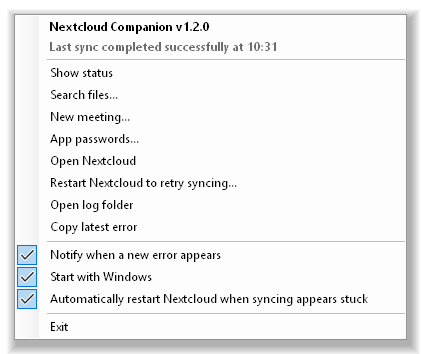
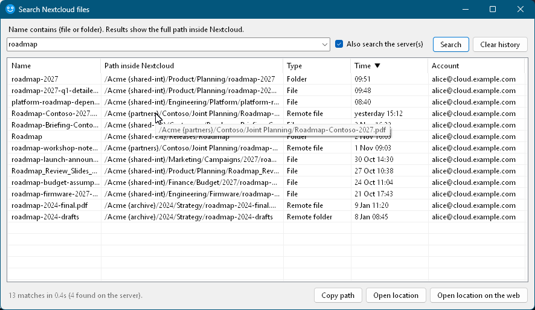

<p align="center">
  
</p>

<h1 align="center">Nextcloud Companion</h1>

<p align="center">
  A friendly Windows system-tray companion for the
  <a href="https://github.com/nextcloud/desktop">Nextcloud desktop client</a>:
  plain-language sync status, full-path file search, and quick meeting creation.
</p>

<p align="center">
  
  &nbsp;&nbsp;
  
</p>

The official client’s tray icon often stays silent: a red X with no message, a grey icon while another account is fine, or a green check while one server is down. The Files web app also hides the full path of a file. This app reads the desktop client’s own config, logs, and sync journals and shows that state directly. It does not replace the sync client.

The executable is `NextcloudCompanion.exe`. Nextcloud Companion is an independent project and is not affiliated with or endorsed by Nextcloud GmbH; its icon only echoes the look of the Nextcloud client icon.

## Install

Download `NextcloudCompanion-Setup-<version>.exe` and run it. It installs for the current user only, to `%LOCALAPPDATA%\Programs\Nextcloud Companion`, and needs no administrator rights. The installer is small (about 3 MB) because it does not include .NET: the app needs the [.NET Desktop Runtime](https://dotnet.microsoft.com/download/dotnet/8.0) (version 8 or newer, x64). If it is missing, Windows says so when you start the app and offers to open the download page; install the runtime and start the app again. Optionally the installer also starts the app when you sign in to Windows. To remove it, use **Settings → Apps → Installed apps**.

The installer is not code-signed, so Windows SmartScreen may warn the first time you run it. To build it yourself, see [Build and run](#build-and-run).

## What it does

- **Tray status.** A badge for every synced folder: green check, grey dash, or red X. The tooltip and the menu’s first line say which folder or server is in trouble.
- **Status flyout.** Click the icon, or choose **Show status**, for each folder’s account, path, last sync, and the latest error.
- **Notifications.** A balloon when overall health becomes an error or a disconnect, or when that summary changes. Already-down servers do not notify on startup. Toggle with **Notify when a new error appears**.
- **File search.** Find a file or folder by part of its name and see the full Nextcloud path (the part the web UI omits). Results can be opened locally or in the Files app. By default it also searches the whole server for files that are not in a synced folder (see below). Up to 100 recent queries are kept.
- **App passwords.** One place (menu: **App passwords…**) to save the app password of each account. They are used for the meeting form and for searching the server.
- **New meeting.** Create an event on a calendar you can write, including internal people and groups. This avoids the Calendar app’s attendee search, which does not reliably find internal users or groups.
- **Restart Nextcloud to retry syncing.** A menu item (and a button in the status window) that closes the Nextcloud client properly, starts it again, and then checks for evidence that syncing resumed. See [Restarting Nextcloud](#restarting-nextcloud).
- **Copy latest error**, **Open Nextcloud**, **Open log folder**, and **Start with Windows**.

One instance runs at a time. It polls about every 4 seconds.

## Status

The tray menu (left screenshot above) leads with the version and a one-line summary, then the actions.

Companion reports what it can see in the desktop client's own files, and says so when it cannot see enough. A running `nextcloud.exe` alone is never shown as healthy: that only means the process exists.

Evidence comes from three places that are kept apart:

- **Configuration** (`nextcloud.cfg`): which accounts and folders exist, and which are paused.
- **The client's log**: the `Sync state changed`, `Sync started/finished`, and `SyncEngine finished` records, attributed to a folder by its account and remote folder, never by local path alone.
- **Connection checks**: whether the server answers. A reachable server does not mean a folder synced, and no connection check is ever shown as a sync result.

| State | Meaning | Icon |
| --- | --- | --- |
| Offline | `nextcloud.exe` is not running |  |
| Error | a folder’s sync log reports a real propagation or engine error |  |
| Disconnected | the account log says the server is disconnected, or `status.php` did not answer |  |
| Warning | a restoration-style problem, or a folder that looks stuck waiting |  |
| Paused | every folder is paused in the client |  |
| Unknown | the client runs, but the logs give no usable or recent evidence |  |
| Ok | every enabled folder has a clean sync result in the log |  |

Overall health uses that order: offline, then any folder error, then any unreachable server, then a warning, then ok. One healthy folder does not hide an unknown one: "No sync result in the logs yet for 1 of 3 folders" is shown instead of a green check. One healthy account does not paint the tray green while another server is down.

Each folder also shows what it is doing now (idle, preparing, syncing, waiting to start, paused) and since when, the time of its last successful sync, and the log file and age of the newest record behind the statement. If the log cannot be found or read, is in a format Companion does not know, or has no recent records, the summary says "Sync status unavailable" or "No recent sync activity was found" instead of repeating an old result. A failed scan publishes that state too; it never leaves an apparently fresh result in place.

Ignored items and soft errors (Office lock files and similar) do not turn the icon red. A server that never answers is a disconnect, not a sync error, including the balloon title.

Sources, all under the user profile unless the client was configured otherwise:

- `%AppData%\Nextcloud\nextcloud.cfg` for accounts and folders (`Folders`, `FoldersWithPlaceholders`, and `Multifolders` groups)
- the client's log directory: the `logDir` set in `nextcloud.cfg`, else the default `%AppData%\Nextcloud\logs`, else the temporary diagnostic directory `%TEMP%\Nextcloud-logdir`; plain and `.gz` rotated files of the last 12 hours. Set `LogDirOverride` in `settings.json` to force a directory
- each folder’s `.sync_*.db` journal for search

Companion has not diagnosed why a client can stop starting its sync runs. It reports what the log shows and offers a restart; whether the restart helps is checked afterwards, not assumed.

## Restarting Nextcloud

**Restart Nextcloud to retry syncing…** (tray menu, and the button in the status window) asks for confirmation, then:

1. Finds exactly one Nextcloud client of your Windows session. It does nothing if there are none, several, or if the executable or the way it was started cannot be read.
2. Asks that client to quit with `nextcloud --quit` and waits for that very process to exit. If it does not exit, it is left running and no second client is started. Only then can you explicitly choose to end it.
3. Starts the same installation again with `--background`, keeping `--confdir`, `--logdir`, `--logfile`, `--logexpire`, `--logflush`, and `--logdebug` if it was started with them.
4. Waits up to three minutes for evidence: every enabled folder must show a successful run, or one in progress, in the log written after the restart. A new process id alone is not reported as recovery. If that evidence does not appear, the result says "could not confirm" and which folders were silent.

Only one restart runs at a time. The restart changes nothing in the client's configuration or sync journals. A restart affects all accounts, which is why it asks first. Steps and outcomes are written to `%AppData%\NextcloudCompanion\recovery.log`.

### Automatic restart (off by default)

**Automatically restart Nextcloud when syncing appears stuck** is opt-in, asks for confirmation when switched on, and is stored in `settings.json`. A folder counts as stuck only when the log shows it explicitly waiting to start, with all of these true:

- it has waited at least 10 minutes in the log and for 10 minutes of Companion's own (monotonic) observation, over several consecutive checks, so a changed system clock cannot trigger it
- no other folder is preparing or syncing, and nothing has progressed meanwhile
- the client has been running, the computer awake, and the account connected for more than two minutes
- no account of that folder is unreachable, needs you to sign in, or has a paused folder, and monitoring is working

A stalled client may stop writing to its log altogether. When the log has sync state records but nothing has been written for 15 minutes, the status reads "No log activity since 10:03; Nextcloud last reported waiting to start syncing". That silence counts toward a stall only if the waiting record was written by the Nextcloud process that is running now.

You can switch the option on or off while Companion runs; evidence collected while it was off counts. While a stall is being counted down, the tooltip and menu say "attempting automatic recovery in about N minutes".

Windows notifications announce an automatic restart when it starts and how it ended (resumed, not confirmed, or failed), when a stall is recognised but the limits prevent a restart, and when the log cannot support automatic restart at all.

An incident gets one automatic attempt. At most 2 automatic restarts happen per 24 hours and at least one hour apart, and that history is saved, so restarting Companion does not reset it. If the history cannot be saved, no automatic restart is made. If the log has no sync state records at all, the feature stays off and says why. Automatic restarts never kill a process.

Passwords are stored with Windows DPAPI for the current user in `%AppData%\NextcloudCompanion\settings.json`. The file holds the encrypted blob, not the password text, and a saved password is never shown again.

## Meetings

**New meeting…** talks to the account with the app password saved under [App passwords](#app-passwords). If the account has none yet, the form says so and its **App passwords…** button opens that window; saving a password there is picked up when you return to the form.

People and groups come from the Files sharing search (`sharees`) and from CardDAV, not from the Calendar attendee autocomplete. A group is expanded to its members when the server allows it; the member list is a snapshot taken when the group is added. The event is written with CalDAV. The form has a **Reminder** choice (default 15 minutes before the start), saved as a display alarm in the event.

## Requirements

- Windows 64-bit
- The Nextcloud desktop client, already signed in (search and status only need its files on disk)
- The .NET 8 (or newer) Desktop Runtime, x64. It is not bundled; Windows offers to download it the first time the app starts without it. To build from source you need the .NET 8 SDK or newer
- Inno Setup 6, only if you build the installer

## Build and run

From this directory:

```powershell
dotnet run --project NextcloudCompanion\NextcloudCompanion.csproj -c Release
```

Publish a framework-dependent build (needs the Desktop Runtime to run) and replace a running copy:

```powershell
Get-Process NextcloudCompanion -ErrorAction SilentlyContinue | Stop-Process
dotnet publish NextcloudCompanion\NextcloudCompanion.csproj -c Release -r win-x64 --self-contained false -o "$env:LOCALAPPDATA\Programs\Nextcloud Companion"
Start-Process "$env:LOCALAPPDATA\Programs\Nextcloud Companion\NextcloudCompanion.exe"
```

Build the per-user installer (no administrator rights; needs [Inno Setup 6](https://jrsoftware.org/isdl.php)):

```powershell
.\build-installer.ps1
```

Output: `artifacts\installer\NextcloudCompanion-Setup-<version>.exe`. The same target runs when you build with `-p:BuildInstaller=true`.

## Command line

| Argument | Effect |
| --- | --- |
| *(none)* | Tray application |
| `--dump` | Write the current status to `%TEMP%\nextcloud-status-dump.txt` and open it: the evidence source and its age, each folder's activity and last success, the observation state, the automatic-restart setting, and recent automatic restarts |
| `--search <text>` | Write search hits to `%TEMP%\nextcloud-status-search.txt` |
| `--show` | Open the status flyout as a normal window |

## Layout

| Path | Role |
| --- | --- |
| `NextcloudCompanion/` | WinForms app (net8.0-windows) |
| `NextcloudCompanion/StatusMonitor.cs` | Scan: ties configuration, logs, and the process into one status snapshot |
| `NextcloudCompanion/ConfigReader.cs`, `LogSources.cs`, `LogAnalyzer.cs` | `nextcloud.cfg` parsing; log discovery and reading; turning records into per-folder evidence |
| `NextcloudCompanion/Models.cs`, `StatusDump.cs` | Status model and computed summary; `--dump` text |
| `NextcloudCompanion/ClientProcess.cs`, `ClientRecovery.cs` | Process control and the restart sequence with verification |
| `NextcloudCompanion/RecoveryCoordinator.cs` | When waiting counts as stuck and an automatic restart is allowed |
| `NextcloudCompanion.Tests/` | Tests (see below), with sanitized client fixtures |
| `NextcloudCompanion/TrayApplicationContext.cs` | Tray icon, menu, polling, notifications |
| `NextcloudCompanion/StatusWindow.cs` | Status flyout |
| `NextcloudCompanion/FileSearch.cs`, `SearchWindow.cs` | Journal search and results |
| `NextcloudCompanion/CalendarClient.cs`, `MeetingWindow.cs` | CalDAV / OCS meeting dialog |
| `NextcloudCompanion/AppPasswordsWindow.cs`, `ServerFileSearch.cs` | App password management; server-side file search (WebDAV `SEARCH`) |
| `NextcloudCompanion/Settings.cs`, `SecretStore.cs` | Settings and DPAPI app passwords |
| `NextcloudCompanion/Dpi.cs`, `DpiForm.cs` | Per-monitor DPI handling: windows re-scale when the DPI or scale factor changes |
| `installer/NextcloudCompanion.iss` | Inno Setup script |
| `build-installer.ps1`, `build-installer.cmd` | Publish, then compile the installer |
| `NextcloudCompanion/app.ico`, `tools/make-icon.py` | Program icon and the script that generates it |
| `docs/images/` | Logo and screenshots used in this README (the search and app password screenshots use made-up data) |

## Tests

The test project has no package dependencies (a small runner is included). From this directory:

```powershell
dotnet run --project NextcloudCompanion.Tests
```

An optional argument filters by test name, for example `dotnet run --project NextcloudCompanion.Tests Recovery`. The tests use sanitized configuration and log fixtures (made-up hosts and users), an injectable clock, and a fake process controller. They never read your real settings or start or stop a real Nextcloud client.

Companion errors are appended to `%AppData%\NextcloudCompanion\error.log`.

## License

[MIT](LICENSE). Nextcloud is a trademark of Nextcloud GmbH; this project is not affiliated with it.
