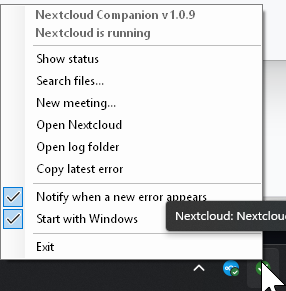
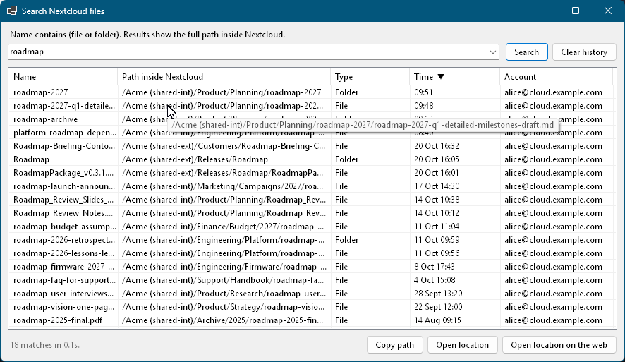

<p align="center">
  
</p>

<h1 align="center">Nextcloud Companion</h1>

<p align="center">
  A friendly Windows system-tray companion for the
  <a href="https://github.com/nextcloud/desktop">Nextcloud desktop client</a>:
  plain-language sync status, full-path file search, and quick meeting creation.
</p>

<p align="center">
  
  &nbsp;&nbsp;
  
</p>

The official client’s tray icon often stays silent: a red X with no message, a grey icon while another account is fine, or a green check while one server is down. The Files web app also hides the full path of a file. This app reads the desktop client’s own config, logs, and sync journals and shows that state directly. It does not replace the sync client.

The executable is `NextcloudCompanion.exe`. Nextcloud Companion is an independent project and is not affiliated with or endorsed by Nextcloud GmbH; its icon only echoes the look of the Nextcloud client icon.

## Install

Download `NextcloudCompanion-Setup-<version>.exe` and run it. It installs for the current user only, to `%LOCALAPPDATA%\Programs\Nextcloud Companion`, and needs no administrator rights. It bundles .NET, so nothing else has to be installed. Optionally it starts the app when you sign in to Windows. To remove it, use **Settings → Apps → Installed apps**.

The installer is not code-signed, so Windows SmartScreen may warn the first time you run it. To build it yourself, see [Build and run](#build-and-run).

## What it does

- **Tray status.** A badge for every synced folder: green check, grey dash, or red X. The tooltip and the menu’s first line say which folder or server is in trouble.
- **Status flyout.** Click the icon, or choose **Show status**, for each folder’s account, path, last sync, and the latest error.
- **Notifications.** A balloon when overall health becomes an error or a disconnect, or when that summary changes. Already-down servers do not notify on startup. Toggle with **Notify when a new error appears**.
- **File search.** Find a file or folder by part of its name and see the full Nextcloud path (the part the web UI omits). Results can be opened locally or in the Files app. Up to 100 recent queries are kept.
- **New meeting.** Create an event on a calendar you can write, including internal people and groups. This avoids the Calendar app’s attendee search, which does not reliably find internal users or groups.
- **Copy latest error**, **Open Nextcloud**, **Open log folder**, and **Start with Windows**.

One instance runs at a time. It polls about every 4 seconds.

## Status

The tray menu (left screenshot above) leads with the version and a one-line summary, then the actions.

Health is taken from the desktop client, not invented here.

| State | Meaning | Icon |
| --- | --- | --- |
| Offline | `nextcloud.exe` is not running |  |
| Error | a folder’s sync log reports a real propagation or engine error |  |
| Disconnected | the account log says the server is disconnected, or `status.php` did not answer |  |
| Warning | a restoration-style problem |  |
| Ok | a recent sync finished cleanly |  |

Overall health uses that order: offline, then any folder error, then any unreachable server, then a warning, then ok. One healthy account does not paint the tray green while another server is down.

Ignored items and soft errors (Office lock files and similar) do not turn the icon red. A server that never answers is a disconnect, not a sync error, including the balloon title.

Sources, all under the user profile:

- `%AppData%\Nextcloud\nextcloud.cfg` for accounts and folders
- `%AppData%\Nextcloud\logs` for the last 12 hours of client logs
- each folder’s `.sync_*.db` journal for search

## File search

<p align="center">
  
</p>

Search matches the file or folder name, not the whole path. It reads a copy of the sync journal (the live database stays with the desktop client). If a journal cannot be read, it falls back to the local disk.

Columns are name, Nextcloud path, type, last change, and account. Click a header to sort. A truncated row’s tooltip shows the full name and path. **Open location** opens a local file in Explorer, a local folder in the shell, or the Files app when the item exists only on the server.

## Meetings

**New meeting…** talks to the account with an [app password](https://docs.nextcloud.com/server/latest/user_manual/en/session_management.html#managing-devices) (Settings → Security → Devices & sessions). The desktop client’s login token is not reused.

Passwords are stored with Windows DPAPI for the current user in `%AppData%\NextcloudCompanion\settings.json`. The file holds the encrypted blob, not the password text.

People and groups come from the Files sharing search (`sharees`) and from CardDAV, not from the Calendar attendee autocomplete. A group is expanded to its members when the server allows it; the member list is a snapshot taken when the group is added. The event is written with CalDAV.

## Requirements

- Windows 64-bit
- The Nextcloud desktop client, already signed in (search and status only need its files on disk)
- .NET is not required for the published build; the installer and the self-contained publish include the runtime
- Inno Setup 6, only if you build the installer

## Build and run

From this directory:

```powershell
dotnet run --project NextcloudCompanion\NextcloudCompanion.csproj -c Release
```

Publish a self-contained build and replace a running copy:

```powershell
Get-Process NextcloudCompanion -ErrorAction SilentlyContinue | Stop-Process
dotnet publish NextcloudCompanion\NextcloudCompanion.csproj -c Release -r win-x64 --self-contained true -o "$env:LOCALAPPDATA\Programs\Nextcloud Companion"
Start-Process "$env:LOCALAPPDATA\Programs\Nextcloud Companion\NextcloudCompanion.exe"
```

Build the per-user installer (no administrator rights; needs [Inno Setup 6](https://jrsoftware.org/isdl.php)):

```powershell
.\build-installer.ps1
```

Output: `artifacts\installer\NextcloudCompanion-Setup-<version>.exe`. The same target runs when you build with `-p:BuildInstaller=true`.

## Command line

| Argument | Effect |
| --- | --- |
| *(none)* | Tray application |
| `--dump` | Write the current status to `%TEMP%\nextcloud-status-dump.txt` and open it |
| `--search <text>` | Write search hits to `%TEMP%\nextcloud-status-search.txt` |
| `--show` | Open the status flyout as a normal window |

## Layout

| Path | Role |
| --- | --- |
| `NextcloudCompanion/` | WinForms app (net8.0-windows) |
| `NextcloudCompanion/StatusMonitor.cs` | Config and log parsing, folder health |
| `NextcloudCompanion/TrayApplicationContext.cs` | Tray icon, menu, polling, notifications |
| `NextcloudCompanion/StatusWindow.cs` | Status flyout |
| `NextcloudCompanion/FileSearch.cs`, `SearchWindow.cs` | Journal search and results |
| `NextcloudCompanion/CalendarClient.cs`, `MeetingWindow.cs` | CalDAV / OCS meeting dialog |
| `NextcloudCompanion/Settings.cs`, `SecretStore.cs` | Settings and DPAPI app passwords |
| `installer/NextcloudCompanion.iss` | Inno Setup script |
| `build-installer.ps1`, `build-installer.cmd` | Publish, then compile the installer |
| `NextcloudCompanion/app.ico`, `tools/make-icon.py` | Program icon and the script that generates it |
| `docs/images/` | Logo and screenshots used in this README (the search screenshot uses made-up data) |

Companion errors are appended to `%AppData%\NextcloudCompanion\error.log`.

## License

[MIT](LICENSE). Nextcloud is a trademark of Nextcloud GmbH; this project is not affiliated with it.
